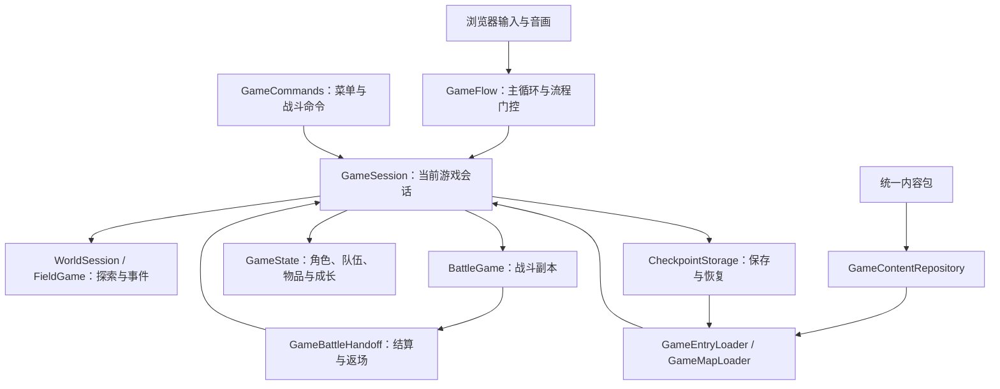

# 游戏系统框架

当前按 [整体系统骨架](game-skeleton.md) 与 [系统推进计划](systems-roadmap.md) 执行：默认可玩入口、单一状态所有权、完整连续流程和批量内容接口优先。既有实现继续使用，个别来源表现或特殊机制不扩大骨架前置清单。历史交付记录见各 `systems-v*.md`。

## 当前可用骨架

默认 `/game/` 是骨架交付入口。启动、探索、事件、战斗返场、菜单和存读档已接通；地图往返与批量路线使用相同公共接口。训练内容用于检验系统组合，完整来源剧情另行迁移。

这张图表示现有模块的接线，不新增状态所有者。每帧仍只有 `GameFlow.advance` 推进时间；战斗、菜单和地图读写同一持久状态。新增内容填写版本化地图、事件、角色和敌队数据，不复制会话或创建另一套演示内核。

| 操作 | 公共入口 | 交付要求 |
| --- | --- | --- |
| 新游戏与恢复 | `GameEntryLoader` | 内容与媒体在私有候选中准备，成功才替换会话。 |
| 移动与交互 | `GameFlow.directionInput` / `confirm` / `choose` | 输入统一门控，事件和剧情仍由 Field 持有；只读目标投影与确认共用规则。 |
| 菜单与战斗输入 | `GameCommands` | 命令绑定当前会话；旧界面不能修改替换后的 owner。 |
| 切图与战斗往返 | `GameMapLoader` / `GameBattleHandoff` | 失败、取消、重试和结算复用原事务；奖励只提交一次。 |
| 保存与继续 | `CheckpointStorage` / `GameEntryLoader` | 内容身份校验、恢复后继续输入，不重跑初始化。 |
| 批量接入 | compiler / `runContentBatchRoute` | 同一候选、一次发布；缺少能力保留完整诊断。 |

2026-10-14 本次重新执行七个代表性检查器，六组公共系统合同和112个连续用例通过；运行时摘要保持 `2047e3057239d4b2fb1f785e573d0223cfa82b0d68bc6b8e930e84b5009b350e`。本地新报告为 `build/reports/v86-skeleton-check.json`。此次没有新增玩法规则；NPC 未集成工作已保存到 ignored WIP。基础骨架收口，下一阶段交付单位为整批内容接入，只有批次实际需要的共用能力才进入实现。

## 框架完成的边界

骨架按系统之间的契约验收：谁持有状态、谁推进时间、异步准备何时发布、剧情任务如何等待和取消、战斗如何归还状态、保存如何重建会话。代表性连续流程通过后，同类内容应当仅通过编译后的数据接入；不要求先复原每一条特殊技能或每一种表现细节。

框架验收、内容批次验收和全游戏迁移验收分别记录。每个内容批次仍须闭合自身依赖，缺少的机制作为共用系统增量实现；不能把未知指令当空操作，也不能让一个尚未使用的特殊机制阻塞全部内容。编译成功、连续运行和原版一致性分别提供证据。现有代表性系统组合已经通过，来源内容扩展按批次推进；实际浏览器、原版对照和完整剧情尚未验收。

## 一套游戏状态

| 模块 | 负责 | 不负责 |
| --- | --- | --- |
| `GameFlow` | 标题、载入、暂停与游玩阶段；宿主时钟和输入门控；异步操作票据与会话发布 | 复制角色、战斗、剧情或地图状态 |
| `GameSession` | 串联字段、战斗、结算与检查点；持有准备候选、战斗借用、固定入场基线和一次性奖励 | 页面节点、网络与图像加载 |
| `WorldSession` / `FieldGame` | 地图切换事务、探索、交互、事件任务和剧情变量 | 为不同地图新增专用规则 |
| `GameState` | 名册、编队、库存、装备、成长、能力、姓名与奖励记录；live/draft 的只读姓名投影 | 另存一份菜单、消息或战斗持久状态 |
| `BattleGame` | 战斗副本中的计时、指令、目标、AI、根事件执行状态、效果、结束许可与结果 | 直接改写存档或重复发奖 |
| `WalkEncounterState` | 会话内唯一探索遇敌随机流、每地图倒计数和事务；随 v5 检查点恢复 | 猜测来源阈值、代替剧情战斗或过滤未支持敌队 |
| `GameContentRepository` | 内容摘要与来源检查、地图索引、依赖加载、并发去重和失败重试 | 发布会话、推进剧情或绕过能力检查 |
| `GameEntryLoader` | 新游戏及读档候选准备、过期拒绝、发布与私有表现清理 | 重新实现入口状态、保存格式或持有状态 |
| `GameCommands` | 为菜单、设置、商店和战斗操作绑定当前会话及阶段 | 自己计算消耗、换装、编队或奖励 |
| `GameMapLoader` | 统一地图读取、世界候选与宿主表现准备、提交、取消和重试 | 复制世界状态、跳过缺失能力、因网络失败丢弃剧情请求 |
| `GameBattleHandoff` | 统一入战、败北重试、返场的宿主准备与 Flow 票据；区分可重试准备失败和发布后错误 | 复制战斗/奖励状态、授予来源交接语义 |
| `CheckpointStorage` | 当前及上一份进度的原子保存 | 信任存档自带的内容或运行能力 |
| `GameEventSaveCoordinator` | 字段保存 barrier 的编码、写盘确认及续行 | 重跑事件、覆盖失败前的有效保存 |
| 浏览器表现 | 键鼠、音画、菜单及媒体准备 | 重新实现游戏时钟和状态所有权 |

`GameFlow.phase` 从现有会话派生探索、事件、对白、选择、商店、战斗、胜利、撤退、失败和阻塞状态。只有标题、暂停及正在执行的宿主操作由 Flow 自己持有。读取阶段不会推进游戏，也不复制第二套游戏状态机。

v49 接通显式开发策略下的普通行走遇敌和原地返场；失败重试保留选定敌队，存取保留倒计数，候选地图不得消耗实时计数。内容编译及批次图按整个敌队池检查依赖，详见 [探索遇敌与战斗返回](systems-v49.md)。

v47 新增 `GameEventSaveCoordinator`：Core 提供保存后的续行点，宿主只编码、同步写盘和确认。取消与写盘失败保留请求，写后异常不允许重试；页面自动处理请求并提供失败重试与返回标题。见 [事件保存与续行](systems-v47.md)。

v46 的标题允许没有 `GameSession`，不需要预先下载旧开发入口。新游戏与读档取得完整内容及媒体后才发布第一会话；来源恢复不依赖未使用的旧纳尔谢字段包。战斗和库存视图跟随已发布会话的目录，详见 [独立入口](systems-v46.md)。

## 连续主循环

标题开始创建一个会话。字段事件发起遭遇，`GameSession` 准备原角色与库存 lease、固定内容和 seed；宿主媒体就绪且原请求仍有效后才构造并发布战斗副本。prepared 模式在这期间丢弃 elapsed，不补跑。默认同步开发适配器也使用同一候选；prepared 模式不能通过旧同步方法绕过准备。

战败重试使用原 lease 和入场基线；取消保留败北战斗。胜利先准备返回事件、演员和成长，再将状态与奖励一次提交并调度字段后继。普通探索撤退等待当前动作完成，取消未执行队列，提交实际资源与排位但不发奖。两种返场在发布前失败都保留结果并可重试；`publicationStarted` 在实际 owned 写入开始后保持为 true，此后的异常不能再次结算。菜单继续读取同一个持有状态。稳定字段状态可以保存；读档先验证内容、重建候选会话和准备媒体，成功后才发布。

显式开发交接仅声明 retain-field 音频和 omit intro，字段音频仍归原所有者。新 framework 内容必须明确声明策略；可信旧开发检查点保留兼容声明。来源 BGM、intro 和逃跑 metadata 独立保留，来源 native 语义仍未准入；音频就绪不是来源许可。

时钟每帧只有一个入口：`GameFlow.advance`。标题、暂停、后台、音频尚未准备、地图总览和存读档期间不推进会话。字段移动、确认和战后继续也通过相同宿主门控。地图切换暂停旧字段，准备内容和表现之后调用既有 `WorldSession.commit`；状态发生变化则拒绝候选。

新游戏、读取、保存、切图、入战和返场共用操作票据。票据只可结束自己的操作，不能让过期请求解锁新操作；过期完成不能替换当前会话或战斗。返回标题与会话替换先撤销私有候选；实际发布开始后若拒绝撤销，原票据与 owner 保留并显式报告。准备失败取消保留原会话及暂停状态，存储失败保留原始字节。

v45 将切图协调从页面移入 `GameMapLoader`。下载或表现准备失败保留原 `MapRequest`，玩家可在同一会话重试；取消丢弃私有候选，迟到结果不能覆盖新会话。世界提交后的 UI 失败不进入重试路径。存档使用 `prepareSave` 编码，在有效票据下同步提交；编码期间离开标题或换会话不会写入旧进度。

战斗和商店操作读取相同的 `inputReady`；暂停菜单允许修改稳定会话，但异步准备期间整块禁用。发布前失败保留旧会话；发布后若表现绑定失败，显式停止并报告原始错误，不把它当作过期请求忽略。音频清理失败也不能掩盖原始错误。

## 内容接入与批量填充

v48 已接入清单驱动的依赖规划和连续路线准入：同一入口、世界、地图和战斗摘要绑定至同一运行时的执行证据；实际玩家输入经过事件、战斗、返场、切图及存档恢复。系统合成清单通过，来源开场清单仍明确 blocked。命令和范围见 [批量内容接入框架](systems-v48.md)。

同一个仓库接口载入开发入口、正式来源入口、世界目录、地图和存档依赖。地图引用必须同时匹配目录摘要、来源集合和地图身份。缓存保留私有副本，每次给调用方独立副本；一次失败不永久缓存拒绝结果。

消息编译绑定完整来源姓名表，普通 `Msg` 和 NPC `Talk` 使用同一模板格式。`FieldMessageNamesPort.prepare(refs)` 返回 detached 姓名快照及 `validate`；字段准备窗口时只读取一次，再与原窗口和实体更新准备一起校验。候选地图使用同一 `prepareFieldState` 草稿端口，成功发布后转向 live owner。持有但不在当前队伍或 disabled 的角色仍按真实身份读取；未持有角色保持阻塞。渲染器只消费已解析文字，不缓存标签、不补默认名。`<CT>` 是整条内容的居中属性，分页与姓名不改变既有确认、等待和任务完成合同。

敌方状态抗性由同一个单怪编译器提供，初始敌人、增援和敌队换轮复用其来源引用。正数 `resistance_condition` 必须闭合组行和 condition master，未知或冲突不变为空字典。运行时复用 `BattleConditions` 和整帧事务；抗性字典既不创建活动状态，也不补缺失的技能、AI、媒体或交接策略。该增量扩大可表达的通用内容，具体敌队仍按完整闭包和连续路线准入。

批量内容的接入单位是已有类型化地图、事件、战斗和角色目录。新增内容的步骤固定为：

1. 来源适配器导出记录与引用，编译器解析为现有类型化指令和机制需求。
2. 依赖闭包检查区分可运行内容及缺少能力的内容，禁止静默跳过未知逻辑。
3. 使用同一内容仓库装载、同一会话运行；新增地图或敌人不修改流程控制。
4. 用连续流程回归检查进度、消耗、奖励、重返与恢复，再扩大同类批次。

开发入口用于把系统连接起来，允许明确记录的临时表现。开发入口通过不等于完整新游戏或主线通过，源粒子缺口也不应继续阻塞这套骨架的构建。

战斗内容的通用选择、逐组编译和诊断见 [遭遇内容管线](battle-catalog.md)。当前队伍菜单通过共享状态事务交换四格位置及前后排；成长和能力详情只读取已持有数据，媒体目录不授予角色，已恢复的能力定义不授予学习进度。

## 实施次序与验收

基础主循环、内容装载、队伍菜单、通用遭遇和剧情选择已接入现有 Web 页面，开始、暂停、重试、存取和重新进入使用统一生命周期。选择回答写入共享事件状态，队伍条件读取同一个持有名册；浏览器不复制剧情。冻结的粒子模块只作为独立成果保留，不启用未完成提供器。

v40 将跨脚本切换与单层返回接入同一字段事件 owner。独立开发内容配置仅省略来源明确、无交互的环境粒子；采用单独摘要链和存档槽，让原始新游戏可以经过第一次地图交接。严格来源包的视觉门禁继续保留。见 [v40 连续框架](systems-v40.md)。

v41 将普通演员与镜头的脚本移动接入共用事件调度。路径和插值各自只有一个所有者，活动插值不能被切图、入战或换脚本丢弃；失败的移动完成提交保留原状态。10 阶段移动集成与原有 12 阶段循环通过，来源开场已继续到下一地图的实体创建边界。见 [v41 共用事件移动](systems-v41.md)。

v42 将 MoveArea 数据纳入既有实体集合，战斗人口条件由当前或事务候选单位派生，观察学习从行动开始到结算、菜单和保存只修改同一持有状态。来源战斗返场先用战后候选角色准备原地图演员、外观、镜头及后续事件，再统一发布奖励与返场；准备失败继续保留胜利状态，允许修复依赖后重试。地图组不另存区域列表，AI 不另存生命状态，菜单不另存技能列表。详情与验证见 [v42 地图、战斗与学习系统](systems-v42.md)。

v43 继续补共用同步对话、跨图资源生命周期和战斗行动状态。窗口输入留在现有字段任务，跨图引用留在既有常驻演员，换列结果留在战斗副本并随胜利返场提交至原编队。统一检查入口重新执行连续系统组合，同时单列来源路线的未完成边界，见 [v43 共用系统集成](systems-v43.md)。

后续依据选定内容批次的完整依赖闭包推进共用系统；交通、多队伍与特殊战斗仅在该批次实际需要时实施，不再扩大基础骨架前置清单。当前次序以 [系统推进计划](systems-roadmap.md) 为准，历史依赖研究见 [框架系统依赖](framework-system-dependencies.md)。

框架验收使用一条连续轨迹：创建会话 → 探索/事件 → 库存与菜单 → 战斗失败/重试 → 胜利/奖励/成长 → 返回字段 → 使用道具 → 保存/恢复 → 继续探索。它同时检查重复确认不重复发奖、失败载入不替换当前状态、旧异步回调不能发布，以及内容失败能重试。浏览器操作另行验证实际接线。完整来源主线、全角色/技能覆盖和其他浏览器兼容仍是后续迁移工作。

执行 `npm run framework:check`，结果写入 `build/reports/game-framework-check.json`；`npm run event-interactions:check` 另检查来源选择、上下文分支和选择→库存→剧情→保存的连续链路；`npm run script-motion:check` 检查共用移动编译和原生演员会话的连续集成。基础框架通过的范围见 [v37 游戏框架](systems-v37.md)，队伍菜单与通用内容管线见 [v38 系统框架](systems-v38.md)，剧情交互见 [v39 系统框架](systems-v39.md)。

骨架集成使用 `npm run skeleton:check`，范围与结果见 [可执行骨架](game-skeleton.md)。`npm run framework:verify` 保留完整细项回归，结果写入 `build/reports/framework-systems-check.json`。汇总中的 `sourceJourney` 和 `readyForBatchPopulation` 独立于受控系统检查是否通过；来源事件在未实现机制处停止时不会得到“已完成主线”的结果。浏览器、音画和原版对照另外验收。

v61 的 `npm run battle-handoff:check` 使用实际 session 与协调器验证 prepared 连续线；默认同步线另保留回归。入战取消、媒体失败、败北重试、返场失败、一次奖励、存取和下一战按同一 owner 验证。已支持通用内容的共同系统合同可独立通过，完整特殊机制与 source-content admission 另列范围。最终结果见 [v61](systems-v61.md)，本批浏览器交接尚未验收，全游戏迁移仍未放行。

当前报告另外单列 `frameworkContracts` 与 `batchAdmission`：前者由实际执行的系统检查决定，后者要求指定来源批次、依赖闭合与留出连续轨迹；不得把来源开场到达稳定点作为全部框架的通过条件。`framework-io:check` 检查地图及存储事务与合成多图闭环，验证范围见 [v45 公共运行框架](systems-v45.md)。
